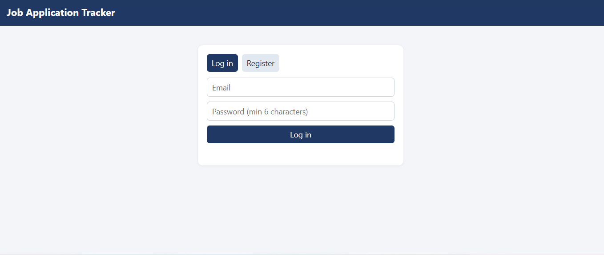
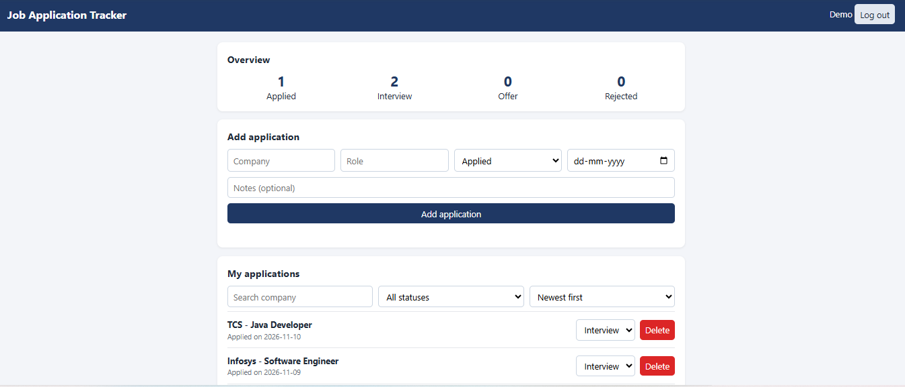
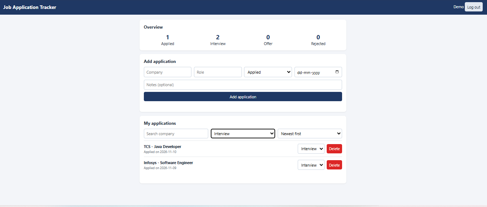
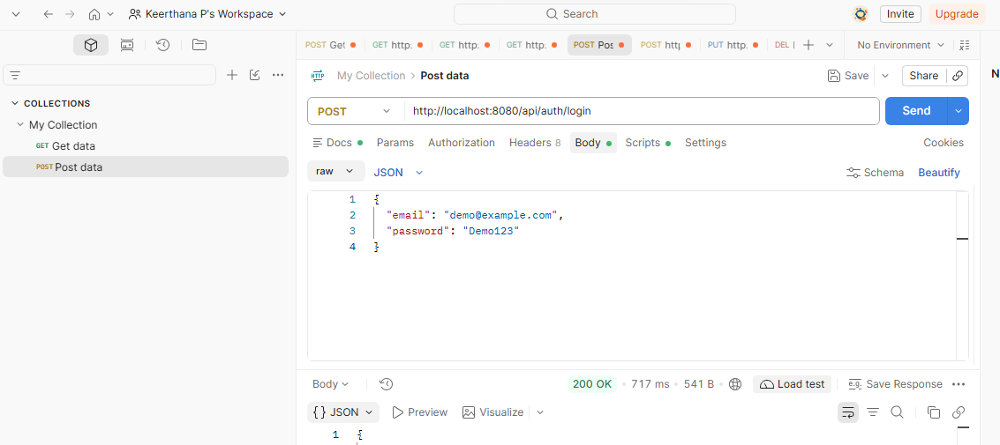
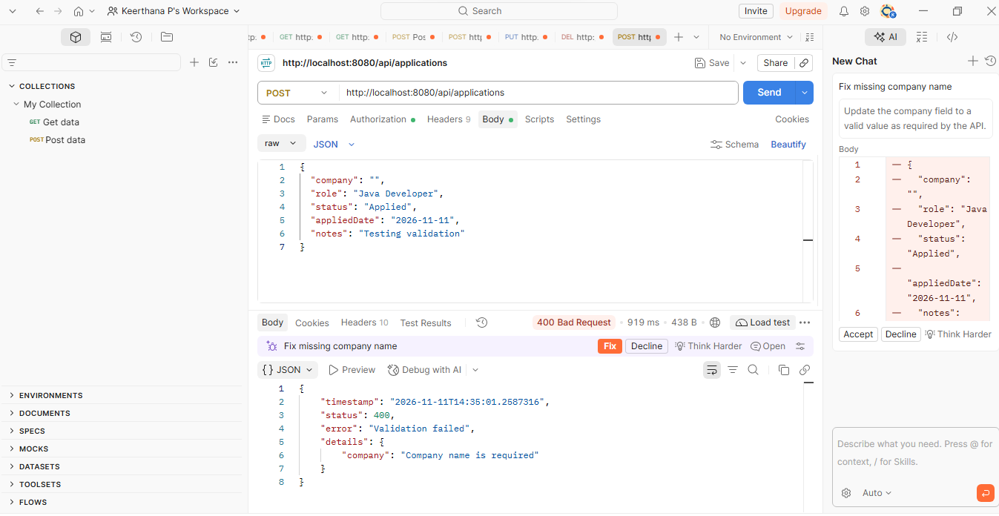
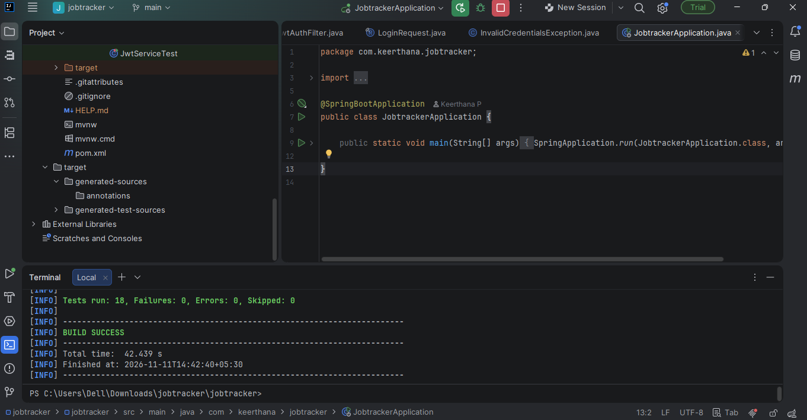

# Job Application Tracker

A full-stack web application built to help users manage and track their job applications.

Users can register, log in, add job applications, update application statuses, search and filter records, and view application statistics. Each user can access only their own applications.


## Live Demo

[Open Job Application Tracker](https://job-application-tracker-fq18.onrender.com)

The application is deployed using Render and uses TiDB Cloud Starter as its MySQL-compatible cloud database.

> **Note:** The demo runs on free hosting. If it hasn't been used recently, the first load can take up to a minute while the server wakes up. You can register with any email address to try it.


## Screenshots

### Login Page


### Dashboard


### Filtered Applications


### Backend Login API


### Validation Error


### Automated Test Results


## Features

- User registration and login
- JWT-based authentication
- Password hashing using BCrypt
- Add, view, update, and delete job applications
- Search applications by company
- Filter applications by status
- Sort applications by applied date
- Dashboard with application statistics
- User-specific data access and isolation
- Input validation and exception handling
- Automated unit tests using JUnit 5 and Mockito


## Tech Stack

| Area | Technology |
|---|---|
| Programming Language | Java |
| Backend | Spring Boot |
| REST APIs | Spring Web |
| Database | MySQL, TiDB Cloud Starter |
| Database Access | Spring Data JPA, Hibernate |
| Security | Spring Security, JWT, BCrypt |
| Frontend | HTML, CSS, JavaScript |
| Testing | JUnit 5, Mockito, Postman |
| Build Tool | Maven |
| Containerization | Docker |
| Deployment | Render |
| IDE | IntelliJ IDEA |
| Version Control | Git and GitHub |


## Architecture

The application follows a layered architecture:

Controller → Service → Repository → Database

- **Controller:** Handles incoming HTTP requests.
- **Service:** Contains business logic and user ownership checks.
- **Repository:** Communicates with the database.
- **Entity:** Represents database tables.
- **JWT Filter:** Validates authentication tokens.
- **Global Exception Handler:** Handles application errors.

## API Endpoints

### Authentication

| Method | Endpoint | Authentication | Description |
|---|---|---|---|
| POST | `/api/auth/register` | No | Register a new user |
| POST | `/api/auth/login` | No | Login and receive JWT token |

### Job Applications

| Method | Endpoint | Authentication | Description |
|---|---|---|---|
| POST | `/api/applications` | Required | Add an application |
| GET | `/api/applications` | Required | View applications |
| GET | `/api/applications/{id}` | Required | View one application |
| PUT | `/api/applications/{id}` | Required | Update an application |
| DELETE | `/api/applications/{id}` | Required | Delete an application |
| GET | `/api/applications/stats` | Required | View application statistics |

Protected endpoints require this HTTP header:

`Authorization: Bearer <your-jwt-token>`


## Run Locally

### Prerequisites

- Java 25
- MySQL
- Git
- IntelliJ IDEA (recommended)

### 1. Clone the repository

```bash
git clone https://github.com/keerthana-p15/job-application-tracker.git
cd job-application-tracker/jobtracker
```

### 2. Create the database

Open MySQL and run:

```sql
CREATE DATABASE jobtracker;
```

### 3. Configure environment variables

Set the following environment variables on your computer:

- `DB_PASSWORD` = your MySQL password
- `JWT_SECRET` = a secure random secret of at least 32 characters

The application also supports `DB_URL` and `DB_USERNAME`. Default values are configured in `application.properties`.

### 4. Run the application

On Windows, open a terminal in the project folder and run:

```bash
.\mvnw.cmd spring-boot:run
```

On macOS or Linux:

```bash
./mvnw spring-boot:run
```

### 5. Open the application

Visit:

http://localhost:8080


## Run Tests

The project includes 18 automated unit tests covering:

- JWT token generation and validation
- Job application service operations
- Input validation

Run the tests using:

```bash
./mvnw test
```

All 18 unit tests passed successfully.


## Deployment

- The app is packaged with a multi-stage **Dockerfile** and deployed as a web service on **Render**.
- The database is a **TiDB Cloud Starter** instance, which is MySQL-compatible and connects over SSL.
- Configuration is passed through environment variables: `DB_URL`, `DB_USERNAME`, `DB_PASSWORD` and `JWT_SECRET`. No credentials are stored in the repository.


## What I Learned

- Building REST APIs using Spring Boot
- Connecting a Java application to MySQL using Spring Data JPA
- Implementing user registration and JWT-based authentication
- Securing passwords using BCrypt
- Applying input validation and exception handling
- Writing unit tests using JUnit 5 and Mockito
- Building a frontend using HTML, CSS, and JavaScript
- Using Git and GitHub for version control
- Containerizing a Spring Boot application with Docker
- Deploying to the cloud with environment-based configuration

## Future Improvements

- Add password reset functionality
- Improve the dashboard with charts
- Add email notifications for interview reminders

## Author

  **Keerthana P**
  B.Tech Computer Science Engineering, Presidency University (2027)
  [LinkedIn](https://linkedin.com/in/keerthana-p-cse) | [GitHub](https://github.com/keerthana-p15)
